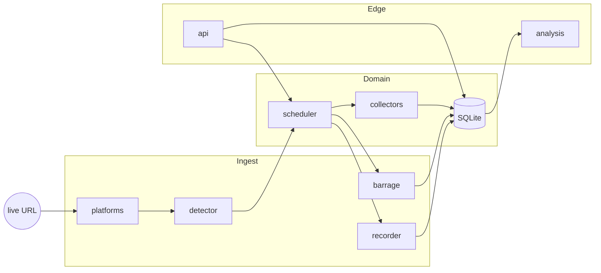

# Live Record Analysis

**直播录制分析 — a live recording and analysis engine in Rust.**

Classify a room URL, detect whether it is on air, ingest up to **10 rooms** with copy-codec ffmpeg, fold realtime danmaku, optionally pull Compass / Qianchuan dashboards, then run ASR + LLM — no Chromium UI.

[English](README.md) · [中文](README.zh-CN.md)

[](https://www.rust-lang.org/)
[](LICENSE)
[](https://sqlite.org/)

---

## Pipeline

```
  URL ──► Probe ──► Ingest ──► Events ──► Collect ──► Diagnose ──► Control plane
 bean     room      ffmpeg     danmaku    dashboards   ASR+LLM     local REST
          enter     slice      wss
```



Seven stages, one process:

1. **Classify** the URL into a platform bean (prefix, then host fallback).
2. **Probe** the room (Douyin webcast enter; HTML markers elsewhere).
3. **Schedule** on `detection_fre` (default 10s), bounded by `max_concurrency` (4) with `stagger_delay_ms` (500). Auto-record when the room is live.
4. **Ingest** FLV/HLS with ffmpeg, sliced on `limit_type=2` minutes (default 240).
5. **Fold** realtime events into `danmu` over a persistent WSS (heartbeat, ack, backoff reconnect).
6. **Collect** optional dashboard adapters (Compass / Qianchuan — cookie-gated).
7. **Diagnose** after stop: 16 kHz mono demux → ASR hook → chat completions.

SQLite is the system of record: `anchor_info`, `anchor_video`, `online_num`, `danmu`, `config`.

## Platforms

| Value | Bean | Prefix |
|---:|---|---|
| 0 | `DouYinLive` / `DouYinAppShareLive` / `DouYinHomeLive` | `live.douyin.com` · `v.douyin.com` · `www.douyin.com/user` |
| 1 | `TiktokLive` | `www.tiktok.com` |
| 2 | `KuaiShouLive` | `live.kuaishou.com` |
| 4 | `RedeLightLive` | `www.redelight.cn` |

## Control plane

The UI (or any client) talks to a loopback JSON server, not to a remote SaaS.

| Method | Path | Role |
|---|---|---|
| `GET` | `/api/system/getMachineCode` | host fingerprint (MD5) |
| `GET` | `/api/config/getuserinfo` | session projection |
| `GET` | `/api/config/settoken` | token inject |
| `GET` | `/api/anchorinfo/GetPageAnchor` | roster |
| `POST` | `/api/anchorinfo/AddOrUpdateAnchor` | `{ "url": "…" }` |
| `GET` | `/api/anchorinfo/Decector` | start detection |
| `GET` | `/api/anchorinfo/StopDecector` | stop detection |
| `GET` | `/api/anchorinfo/StartRecord?id=` | force ingest |
| `GET` | `/api/anchorinfo/StopRecord?id=` | stop ingest |
| `GET` | `/api/anchorvideo/list` | segments |
| `POST` | `/api/anchorvideo/CreateAnalysis` | ASR + LLM |

Envelope: `{ "code": 0, "msg": "ok", "data": … }`. Unknown paths: `{ "code": -9, "msg": "资源不存在" }`.

## Crate layout

```
src/
├── main.rs          CLI: probe | add | list | serve
├── lib.rs           public surface + tests
├── platforms.rs     URL / bean router
├── detector.rs      room probe
├── recorder.rs      ffmpeg segmenter, dry-run fallback
├── barrage.rs       event map + BarrageHub
├── barrage_ws.rs    persistent WSS, heartbeat, backoff
├── webcast.rs       PushFrame / gzip / chat-gift decode
├── collectors.rs    live-meta / compass / qianchuan
├── scheduler.rs     detection thread + auto-record
├── analysis.rs      demux + Ark chat completions
├── api.rs           std TCP JSON server
├── db.rs            rusqlite (bundled)
├── session.rs       Douyin cookie jar (ttwid)
├── crypto.rs        machine-code MD5
├── models.rs        domain types
└── pipeline.rs      composition root
```

Constraints:

- **No async runtime.** Detection, ffmpeg, and HTTP are OS threads. One binary, predictable scheduling.
- **ffmpeg is the recorder.** Copy-codec slice (`-c copy -t N`) plus HTTP reconnect (`-reconnect 1`). A dropped socket opens the next paragraph file instead of killing the session.
- **Dry-run without ffmpeg.** Writes an `FLV\x01` placeholder so the scheduler can be tested on a laptop.
- **Collectors are capability-gated.** Dashboard endpoints exist; sessions are not invented.

## Build

```bash
rustc 1.70+
cargo test
cargo run -- probe https://live.douyin.com/<web_rid>
cargo run -- add  https://live.douyin.com/<web_rid>
cargo run -- list
cargo run -- serve --host 127.0.0.1 --port 5001
cargo run -- barrage https://live.douyin.com/<web_rid>
cargo run -- watch https://live.douyin.com/<web_rid>
cargo run -- collect https://live.douyin.com/<web_rid>
cargo run -- analyze recordings/xxx.flv --title '场次'
cargo run -- session --platform compass --set '<cookie>'
cargo run -- session --platform qianchuan --set '<cookie>'
```

Ten concurrent copies: default `HD1` (`LIVE_QUALITY=FULL_HD1|HD1|SD1`). ffmpeg is `nice 10` / 1 thread / `-c copy`. Danmaku is batched into SQLite. WSS signatures stay in a warm Node process. ASR runs one whisper at a time (`WHISPER_BIN`).

`GET /api/system/status` → `slots_used` / `slots_max`. `GET /api/config/auth` → compass / qianchuan cookie presence.

Room enter is cookie-sensitive. Persist a Douyin web cookie (at least `ttwid`) so probe and barrage share the same jar:

```bash
cargo run -- session --refresh
cargo run -- session --set 'ttwid=...; msToken=...'
```

`GET /api/config/session` shows keys only (prefix, not the secret). Missing cookies still classify the URL; enter may return `error: "bad json"`. Ingest needs `ffmpeg` on `PATH`.

Barrage WSS is signed **locally**: MD5 stub → original `fp.data` `frontierSign` (Node). Copy `fp/fp.data` from the desktop install to `data/fp.data` (gitignored). `node` must be on `PATH`.

```bash
cp /path/to/fp.data data/fp.data
cargo run -- barrage https://live.douyin.com/<web_rid>
```


`ARK_API_KEY` enables Volcengine Ark completions (`doubao-pro-32k`). Without it, diagnosis returns a structured placeholder.

## Design notes

**The UI is not the engine.** Chromium, Electron, or a thin web shell can sit in front of `serve`. The process that classifies, records, and diagnoses should not own a browser.

**Fingerprint is MD5, not TPM.** `crypto::machine_code` concatenates cpu / disk / board identifiers and hashes them. No license binding is implemented.

**Slice policy lives in `config`.** `limit_type = 2` means duration (minutes); `limit_value = "240"` is a four-hour segment. Size-based slicing (`limit_type = 1`) is reserved in the schema.

## Status

Covered by tests: URL algebra, SQLite roster, local REST, danmaku type map, gzip PushFrame roundtrip, machine-code, REST dispatch.

```
cargo test
# 16 passed
```

## License

MIT. See [LICENSE](LICENSE).
