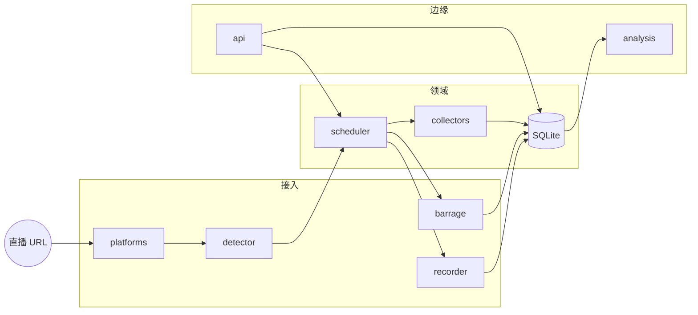

# 直播录制分析

**Live Record Analysis — 用 Rust 写的直播录制与分析引擎。**

识别直播间 URL、探测是否开播、最多同时 **10 路** ffmpeg 拷流、折叠实时弹幕、按需拉巨量罗盘 / 千川看板，再走 ASR + LLM。没有 Chromium 界面。

[English](README.md) · [中文](README.zh-CN.md)

[](https://www.rust-lang.org/)
[](LICENSE)
[](https://sqlite.org/)

---

## 流水线

```
  URL ──► 探测 ──► 拉流 ──► 事件 ──► 采集 ──► 诊断 ──► 控制面
 bean     房间     ffmpeg    弹幕     看板      ASR+LLM    本地 REST
          enter    切片      wss
```



七段，一个进程：

1. **分类**：URL → 平台 bean（前缀优先，其次 host）。
2. **探测**：抖音走 webcast enter，其它平台读页面标记。
3. **调度**：间隔 `detection_fre`（默认 10 秒），并发上限 `max_concurrency`（4），启动错峰 `stagger_delay_ms`（500）。开播则自动录。
4. **拉流**：ffmpeg 吃 FLV/HLS，按 `limit_type=2` 的分钟数切片（默认 240）。
5. **折叠**：常驻 WSS 收实时事件写入 `danmu`（心跳、ack、退避重连）。
6. **采集**：可选看板适配器（罗盘 / 千川，需要登录态）。
7. **诊断**：停录后解 16 kHz 单声道 → ASR → chat completions。

SQLite 是系统账本：`anchor_info`、`anchor_video`、`online_num`、`danmu`、`config`。

## 平台

| Value | Bean | 前缀 |
|---:|---|---|
| 0 | `DouYinLive` / `DouYinAppShareLive` / `DouYinHomeLive` | `live.douyin.com` · `v.douyin.com` · `www.douyin.com/user` |
| 1 | `TiktokLive` | `www.tiktok.com` |
| 2 | `KuaiShouLive` | `live.kuaishou.com` |
| 4 | `RedeLightLive` | `www.redelight.cn` |

## 控制面

界面（或任意客户端）只打本地 JSON，不直连远程 SaaS。

| Method | Path | 作用 |
|---|---|---|
| `GET` | `/api/system/getMachineCode` | 主机指纹（MD5） |
| `GET` | `/api/config/getuserinfo` | 会话投影 |
| `GET` | `/api/config/settoken` | 写入 token |
| `GET` | `/api/anchorinfo/GetPageAnchor` | 主播列表 |
| `POST` | `/api/anchorinfo/AddOrUpdateAnchor` | `{ "url": "…" }` |
| `GET` | `/api/anchorinfo/Decector` | 启动探测 |
| `GET` | `/api/anchorinfo/StopDecector` | 停止探测 |
| `GET` | `/api/anchorinfo/StartRecord?id=` | 强制录制 |
| `GET` | `/api/anchorinfo/StopRecord?id=` | 停止录制 |
| `GET` | `/api/anchorvideo/list` | 切片列表 |
| `POST` | `/api/anchorvideo/CreateAnalysis` | ASR + LLM |

响应包络：`{ "code": 0, "msg": "ok", "data": … }`。未知路径：`{ "code": -9, "msg": "资源不存在" }`。

## 目录

```
src/
├── main.rs          CLI：probe | add | list | serve
├── lib.rs           对外接口 + 测试
├── platforms.rs     URL / bean 路由
├── detector.rs      房间探测
├── recorder.rs      ffmpeg 切片，无 ffmpeg 时 dry-run
├── barrage.rs       事件映射 + BarrageHub
├── barrage_ws.rs    常驻 WSS，心跳，退避重连
├── webcast.rs       PushFrame / gzip / 弹幕礼物解码
├── collectors.rs    直播元数据 / 罗盘 / 千川
├── scheduler.rs     探测线程 + 自动录制
├── analysis.rs      解复用 + 方舟 chat completions
├── api.rs           标准库 TCP JSON 服务
├── db.rs            rusqlite（bundled）
├── session.rs       抖音 cookie 罐（ttwid）
├── crypto.rs        机器码 MD5
├── models.rs        领域类型
└── pipeline.rs      组合根
```

约束：

- **不用异步运行时。** 探测、ffmpeg、HTTP 都是 OS 线程。单二进制，调度可预期。
- **录制器就是 ffmpeg。** `-c copy -t N`，并打开 HTTP 重连（`-reconnect 1`）。断流写下一段文件，不拆掉整场。
- **没有 ffmpeg 就 dry-run。** 写 `FLV\x01` 占位，笔记本上也能跑调度。
- **采集按能力开门。** 看板地址在，会话不造假。

## 构建

```bash
rustc 1.70+
cargo test
cargo run -- probe https://live.douyin.com/<web_rid>
cargo run -- add  https://live.douyin.com/<web_rid>
cargo run -- list
cargo run -- serve --host 127.0.0.1 --port 5001
cargo run -- barrage https://live.douyin.com/<web_rid>
cargo run -- watch https://live.douyin.com/<web_rid>
cargo run -- collect https://live.douyin.com/<web_rid>
cargo run -- analyze recordings/xxx.flv --title '场次'
cargo run -- session --platform compass --set '<cookie>'
cargo run -- session --platform qianchuan --set '<cookie>'
```

十路并发默认 `HD1`（`LIVE_QUALITY=FULL_HD1|HD1|SD1`）。ffmpeg `nice 10`、单线程、`-c copy`。弹幕批量写入 SQLite。WSS 签名常驻一个 Node 进程。ASR 同一时刻只跑一个 whisper（`WHISPER_BIN`）。

`GET /api/system/status` 看 `slots_used` / `slots_max`。`GET /api/config/auth` 看巨量 / 千川 cookie 是否已授权。

房间探测对 cookie 敏感。把抖音网页 cookie（至少 `ttwid`）存下来，探测和弹幕共用：

```bash
cargo run -- session --refresh
cargo run -- session --set 'ttwid=...; msToken=...'
```

`GET /api/config/session` 只回 keys / 前缀，不回完整密钥。没有 cookie 时 URL 分类仍可用，enter 可能是 `error: "bad json"`。拉流需要 `PATH` 里有 `ffmpeg`。

弹幕 WSS **本地签**：MD5 stub → 原版 `fp.data` 的 `frontierSign`（Node）。把安装包里的 `fp/fp.data` 拷到 `data/fp.data`（已 gitignore）。`PATH` 里要有 `node`。

```bash
cp /path/to/fp.data data/fp.data
cargo run -- barrage https://live.douyin.com/<web_rid>
```


设置 `ARK_API_KEY` 后走火山方舟（`doubao-pro-32k`）。没有 key 时诊断返回结构化占位。

## 设计

**界面不是引擎。** Chromium、Electron 或薄 Web 壳都可以挂在 `serve` 前面。分类、录制、诊断不该绑一个浏览器。

**指纹是 MD5，不是 TPM。** `crypto::machine_code` 把 cpu / 磁盘 / 主板标识拼起来做哈希。这里没有授权绑定。

**切片策略在 `config`。** `limit_type = 2` 表示按时长（分钟）；`limit_value = "240"` 是四小时一段。按体积切片（`limit_type = 1`）只在表结构里留了位。

## 状态

测试覆盖：URL 代数、SQLite 名录、本地 REST、弹幕类型映射、gzip PushFrame 往返、机器码、路由分发。

```
cargo test
# 16 passed
```

## 许可

MIT，见 [LICENSE](LICENSE)。
